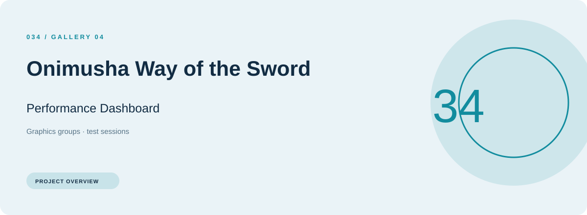
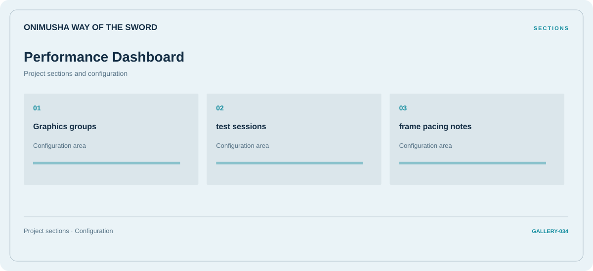

# ⚡ Onimusha Way of the Sword Performance Dashboard

**Graphics groups · Test sessions · Frame pacing notes**

## ⚡ Features

A performance dashboard workspace for Onimusha Way of the Sword, built around graphics groups and test sessions, with frame pacing notes kept in a separate reference area.

### ⚙️ Graphics groups

Display or performance-related options, with space for configuration and comparison information.

### 🧩 Test sessions

Session and activity information grouped by the task or context it belongs to.

### ⌨️ Frame pacing notes

Display or performance-related options, with space for configuration and comparison information.

## 🖥️ Project navigation

## 📥 Download

The button and cover open the project's download page. Use the information supplied with the downloaded package for installation and release-specific requirements.

## 📚 Project documentation

- [Feature reference](docs/FEATURES.md)
- [Download information](docs/DOWNLOAD.md)
- [Project page](index.html)

---

Onimusha Way of the Sword Performance Dashboard · Program documentation and download information.
